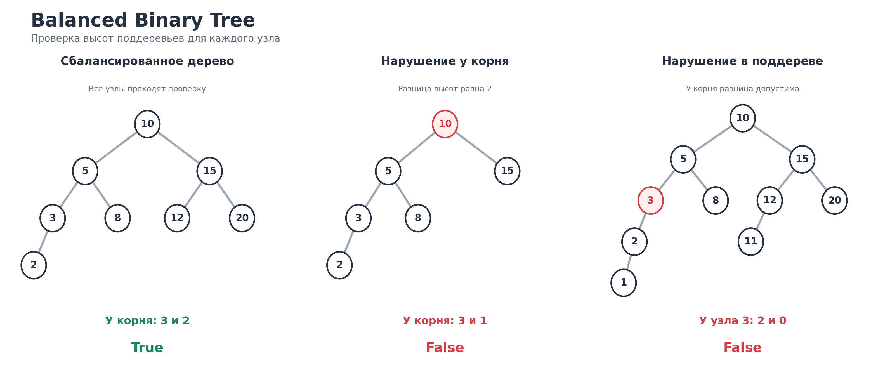

# Задача 3. Balanced Binary Tree

## Корректность решения

Реализовал функцию is_balanced, которая проверяет, является ли бинарное дерево сбалансированным по высоте. Для каждого узла высоты его левого и правого поддеревьев должны отличаться не более чем на 1. Если это условие не выполняется хотя бы для одного узла, функция возвращает False.

Проверять только высоты двух поддеревьев корня недостаточно. Они могут иметь почти одинаковую высоту, но внутри одного из них всё равно может находиться несбалансированный узел. Поэтому алгоритм проверяет условие для каждого узла, начиная с самых нижних.

Высота отсутствующего поддерева равна 0, высота листа равна 1. Когда высоты обоих поддеревьев уже известны, высота текущего узла равна единице плюс максимальная из них. Если разница высот больше 1, проверка сразу завершается с результатом False.

Так как каждый узел обрабатывается только после своих потомков, для него используются уже правильно посчитанные высоты. Если ни у одного узла нарушение не найдено, дерево сбалансировано и функция возвращает True.

Пустое дерево и дерево из одного узла считаются сбалансированными. Значения в узлах на результат не влияют, важна только форма дерева. В отличие от предыдущей задачи Validate BST, здесь не требуется, чтобы значения слева были меньше, а справа больше. Повторяющиеся значения также допустимы.

## Идея решения

Сначала можно было бы для каждого узла отдельно вычислять высоты левого и правого поддеревьев. Но тогда одни и те же части дерева пришлось бы проходить многократно. Например, в дереве в виде цепочки это привело бы к O(n²) по времени.

В итоге использовал обход postorder, при котором сначала обрабатываются оба поддерева, а затем сам узел. Высота каждого поддерева вычисляется только один раз.

Вместо рекурсивных вызовов использовал два обычных списка. В stack сохраняются пары из узла и значения visited. В heights сохраняются высоты уже обработанных поддеревьев.

Если visited равно False, узел ещё не готов к проверке. Поэтому он снова добавляется в stack, но уже с visited равным True. Затем в стек добавляются его правый и левый потомки, если они существуют.

Так как стек работает по принципу LIFO, сначала будет полностью обработано левое поддерево, затем правое и только после этого текущий узел.

Когда visited равно True, высоты потомков уже находятся в heights. Если правый потомок есть, сначала достаём его высоту. Затем аналогично берём высоту левого потомка. Именно в таком порядке, потому что левое поддерево было обработано раньше правого и его высота находится ниже в стеке.

Для отсутствующего потомка высота принимается равной 0. После этого сравниваем две высоты. Если их разница больше 1, возвращаем False. Иначе вычисляем высоту текущего узла и сохраняем её в heights для проверки его родителя.

Таким способом не нужно создавать словарь высот для всех узлов. В памяти остаются только ещё не обработанные узлы и высоты завершённых поддеревьев на текущем пути. Само дерево не изменяется.

## Оценка сложности

Пусть n это количество узлов дерева, а h его высота.

Время O(n) в худшем случае.

Каждый узел один раз попадает в стек для обработки потомков и один раз для вычисления собственной высоты. Для каждого узла выполняется постоянное количество операций, включая извлечение высот, сравнение и добавление результата в список. Поэтому при сбалансированном дереве нужно обработать все n узлов, и общее время O(n).

Если несбалансированный узел находится раньше по порядку обхода, алгоритм может завершиться быстрее. Но худшая оценка от этого не меняется.

Дополнительная память O(h).

В stack одновременно находятся узлы текущего пути и отложенные поддеревья. На каждом уровне остаётся постоянное количество таких элементов. В heights сохраняются результаты уже завершённых поддеревьев, которые ещё нужны их предкам. Их количество тоже ограничено высотой дерева.

Поэтому для дерева высоты h дополнительная память O(h). Для сбалансированного дерева это O(log n), а для дерева в виде длинной цепочки в худшем случае O(n). Само дерево в оценку дополнительной памяти не входит.

Если бы использовалась рекурсия, асимптотика была бы той же, но очень глубокое дерево могло бы привести к RecursionError из-за ограничения Python на количество вложенных вызовов. Итеративная реализация этого ограничения не имеет.

Функция build_tree нужна только для запуска программы из командной строки. Она строит узлы из входной последовательности за O(n) времени и O(n) памяти с учётом самого создаваемого дерева. Эти затраты не относятся к проверке is_balanced.

## Визуализация

Рассмотрим дерево:

```text
         10
        /  \
       5    15
      / \   / \
     3   8 12  20
    /
   2
```

Алгоритм сначала спускается к самому нижнему узлу слева. Для узла 2 оба поддерева пустые, их высоты равны 0. Высота узла 2 получается равной 1.

У узла 3 высота слева равна 1, справа 0. Разница равна 1, поэтому узел допустим. Его высота равна 2.

Затем обрабатывается узел 8. Это лист, поэтому его высота равна 1.

Теперь можно проверить узел 5. Слева находится поддерево высоты 2, справа поддерево высоты 1. Разница равна 1, поэтому узел сбалансирован. Его высота равна 3.

После этого проверяем правое поддерево корня. Узлы 12 и 20 имеют высоту 1. У узла 15 оба поддерева высоты 1, поэтому его высота равна 2.

Наконец, у корня 10 высота левого поддерева равна 3, а правого 2. Разница равна 1. Ни у одного узла нарушения не было, поэтому результат True.

Изменим дерево так, чтобы у корня остались потомки 5 и 15, но у узла 15 больше не было собственных потомков.

```text
         10
        /  \
       5    15
      / \
     3   8
    /
   2
```

В левом поддереве корня все узлы ещё сбалансированы. Высота поддерева с корнем 5 равна 3. Правое поддерево состоит только из узла 15, поэтому его высота равна 1.

Когда алгоритм доходит до корня 10, разница высот равна 2. Условие нарушено, результат False.

Есть и более интересный случай, когда у самого корня разница высот не превышает 1, но дерево всё равно несбалансировано.

```text
          10
        /    \
       5      15
      / \    /  \
     3   8  12  20
    /       /
   2       11
  /
 1
```

Начинаем с самого нижнего узла 1. Его высота равна 1. У узла 2 высота слева равна 1, справа 0, поэтому его высота равна 2. У узла 3 высота слева равна 2, а справа 0. Разница равна 2, поэтому именно здесь функция обнаруживает нарушение и сразу возвращает False.

Даже если отдельно посчитать полные высоты обеих сторон корня 10, они будут равны 4 и 3. Сам корень при этом выглядит сбалансированным. Но узел 3 внутри левого поддерева уже нарушает условие, поэтому проверять только корень нельзя.

Все три дерева показаны на изображении. Красным выделены узлы, на которых нарушается баланс.



## Тесты

Проверяется пустое дерево, один узел, два потомка, отсутствие одного из потомков, разница высот 1 и разница высот больше 1. Отдельно проверяется случай, в котором высоты поддеревьев корня почти одинаковые, но внутри одного поддерева находится нарушение.

Также проверяются деревья с одинаковыми значениями, отрицательными числами и строками. Результат не должен зависеть от значений узлов, только от их расположения. Есть отдельный тест на дерево, которое сбалансировано по высоте, хотя не удовлетворяет свойствам BST.

Проверяются полностью заполненные деревья высотой до 12 уровней, включая дерево из 4095 узлов. Отдельные тесты строят левую и правую цепочки по 5001 узлу, чтобы убедиться в отсутствии проблем с глубиной рекурсии.

Для всех 2056 возможных форм бинарного дерева с количеством узлов от 0 до 8 результат сравнивается с независимой проверкой. Дополнительно для 600 случайных бинарных деревьев результат сравнивается с отдельной рекурсивной реализацией, которая вычисляет высоты и проверяет баланс независимо от основного алгоритма. На этих деревьях глубина небольшая, поэтому эталонную функцию безопасно использовать с рекурсией.

Проверяется, что повторные вызовы дают одинаковый ответ, а функция не изменяет значения и ссылки узлов. После изменения структуры дерева результат должен измениться, если нарушается баланс.

Для дополнительного ввода через build_tree проверяются пустое дерево, пропущенные потомки, сохранение входного списка и некорректные последовательности с лишними узлами. Отдельные тесты запускают Python-файл как программу и сверяют напечатанные True или False с ожидаемыми результатами.

Для запуска тестов из корня репозитория:

```bash
python -m pytest -q homework_4/balanced_binary_tree/test_balanced_binary_tree.py
```

Для запуска самой программы:

```bash
python homework_4/balanced_binary_tree/balanced_binary_tree.py
```

Входные значения задаются по уровням слева направо. Отсутствующий узел обозначается null. Например:

```text
10 5 15 3 8 12 20 2
```

Результат True.

Для второго дерева:

```text
10 5 15 3 8 null null 2
```

Результат False.

В условии не указан конкретный формат ввода бинарного дерева, поэтому ввод по уровням добавлен для удобства самостоятельной проверки. Основной алгоритм is_balanced принимает корень уже построенного дерева.
