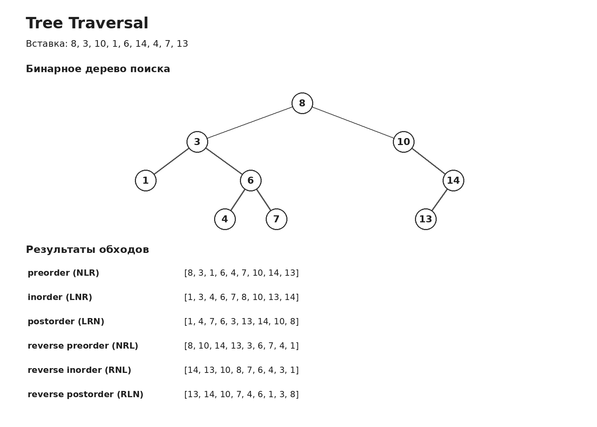

# Задача 1. Tree Traversal

## Корректность решения

Реализовано бинарное дерево поиска с добавлением новых элементов и шестью способами обхода.

При вставке новое число сравнивается с текущим узлом. Если оно меньше, переходим в левое поддерево, если больше, в правое. Так продолжается, пока не найдётся свободное место для нового узла.

Если такое значение уже есть в дереве, второй раз оно не добавляется.

Поэтому после каждой вставки сохраняется свойство BST. Все значения в левом поддереве меньше значения текущего узла, а в правом больше.

Каждый обход посещает все узлы ровно один раз и возвращает список значений. При этом само дерево не изменяется.

## Идея решения

Для обходов использовал стек. Это позволяет обойти дерево без рекурсии и не зависеть от ограничения Python на глубину рекурсивных вызовов.

У каждого обхода свой порядок посещения текущего узла и двух его поддеревьев. Обозначил текущий узел буквой N, левое поддерево буквой L, правое буквой R.

Для preorder порядок NLR. Сначала берётся текущий узел, потом левое поддерево и только после этого правое.

Для inorder порядок LNR. Сначала обрабатывается левое поддерево, затем текущий узел и правое поддерево.

Для postorder порядок LRN. Текущий узел добавляется в результат только после обоих поддеревьев.

В обратных обходах меняется порядок левого и правого поддерева. Для reverse preorder получается NRL, для reverse inorder RNL, для reverse postorder RLN.

Чтобы не писать шесть раз почти один и тот же код, сделал общий метод _traverse. Он получает нужный порядок из трёх букв.

В стеке сохраняется узел и отметка, нужно ли уже добавить его значение в результат. Если отметки нет, алгоритм раскладывает обработку узла и его поддеревьев на отдельные действия. Если отметка есть, значение записывается в список.

Стек работает по принципу LIFO, поэтому действия добавляются в него в обратном порядке. Тогда при извлечении они выполняются именно в той последовательности, которая нужна для конкретного обхода.

Например, для preorder сначала в стек добавляется правое поддерево, потом левое и затем действие для самого узла. При извлечении сначала обрабатывается узел, после него левая часть дерева, потом правая.

## Оценка сложности

Пусть n это количество узлов дерева, а h его высота.

Вставка: O(h).

При добавлении нового значения алгоритм проходит только по одной ветке дерева. Если дерево достаточно сбалансировано, его высота порядка log n, поэтому вставка занимает O(log n). Если вставлять числа в отсортированном порядке, дерево может превратиться в цепочку и вставка займёт O(n).

Память для одной вставки: O(1).

Вставка использует только несколько ссылок и не создаёт дополнительный список или рекурсивные вызовы.

Время любого обхода: O(n).

Каждый узел обрабатывается постоянное количество раз, поэтому форма дерева не влияет на итоговую асимптотику обхода.

Память обхода: O(h) для стека и O(n) для списка результата.

Все значения нужно вернуть в списке, поэтому суммарно память составляет O(n). Сам стек при этом может занимать O(log n) для сбалансированного дерева или O(n) для вытянутого дерева.

Построение дерева из n значений занимает O(n log n) в среднем при случайном порядке вставки и O(n²) в худшем случае.

## Визуализация


Пусть элементы вставляются в следующем порядке:

[8, 3, 10, 1, 6, 14, 4, 7, 13]

Первым добавляется 8, поэтому оно становится корнем дерева. Число 3 меньше 8 и попадает слева. Число 10 больше 8 и попадает справа. Остальные значения добавляются по тому же правилу.

Получается дерево 
Для preorder сначала посещаем корень 8, затем всю левую часть дерева начиная с 3 и только после этого правую часть начиная с 10.

preorder = [8, 3, 1, 6, 4, 7, 10, 14, 13]

Для inorder сначала посещается самая левая ветка. В бинарном дереве поиска этот обход возвращает числа по возрастанию.

inorder = [1, 3, 4, 6, 7, 8, 10, 13, 14]

Для postorder сначала обрабатываются дочерние узлы. Корень 8 оказывается последним в результате.

postorder = [1, 4, 7, 6, 3, 13, 14, 10, 8]

Обратные обходы посещают правое поддерево раньше левого, поэтому результаты меняются.

reverse preorder = [8, 10, 14, 13, 3, 6, 7, 4, 1]

reverse inorder = [14, 13, 10, 8, 7, 6, 4, 3, 1]

reverse postorder = [13, 14, 10, 7, 4, 6, 1, 3, 8]

Отдельная схема дерева и всех шести обходов приведена в файле visualization.png.

Если вставлять [1, 2, 3], получится дерево, в котором каждый новый узел находится справа от предыдущего.


Для такого дерева высота равна количеству узлов. Итеративный обход со стеком продолжает работать, даже если дерево очень глубокое.

## Тесты

Проверяются все шесть обходов на одном дереве, пустое дерево, дерево с одним элементом и правильность вставки положительных и отрицательных чисел.

Также проверяются повторяющиеся значения, дерево только с левыми потомками, дерево только с правыми потомками и то, что обходы не меняют содержимое дерева.

Отдельно проверяется дерево из 1500 узлов, построенное из отсортированных чисел. Такой случай нужен, чтобы убедиться, что обходы не падают из-за ограничения глубины рекурсии.

Тесты запускаются из корня репозитория командой:

```bash
python -m pytest -q homework_4/tree_traversal/test_solution.py
```
