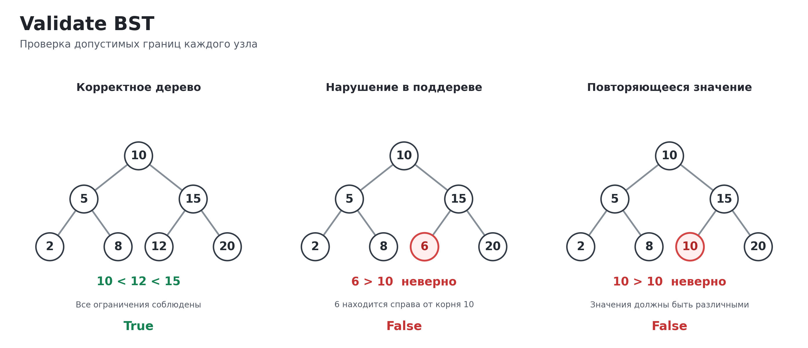

# Задача 2. Validate BST

## Корректность решения

Реализовал функцию is_valid_bst, которая проверяет произвольное бинарное дерево и возвращает True, если оно удовлетворяет свойствам BST, и False в остальных случаях.

Для каждого узла все значения в левом поддереве должны быть строго меньше его значения, а все значения в правом поддереве строго больше. Проверять только непосредственных потомков недостаточно. Например, число 6 может находиться слева от узла 15, но если сам узел 15 находится справа от корня 10, число 6 нарушает свойство BST.

Поэтому для каждого узла сохраняются нижняя и верхняя допустимые границы. При переходе в левое поддерево верхняя граница ограничивается значением родителя, при переходе в правое поддерево ограничивается нижняя граница. Ограничения от более ранних предков не теряются.

Если значение узла выходит за границы или совпадает с одной из них, функция возвращает False. Если все узлы прошли проверку, возвращается True. Так гарантируется выполнение свойства BST для каждого узла относительно всех его предков, а не только родителя.

Дубликаты считаются ошибкой. Это согласуется с первой задачей, где повторное значение в BST не вставляется. Пустое дерево и дерево из одного узла считаются корректными.

## Идея решения

Сначала можно было бы сравнивать каждый узел только с его левым и правым потомком. Но такой подход не обнаруживает нарушение, которое находится глубже в поддереве. Поэтому использовал проверку через допустимый диапазон значений.

В стек кладётся корень с двумя границами None. Это означает, что для корня изначально нет ограничений ни снизу, ни сверху.

На каждом шаге из стека достаются текущий узел, нижняя граница lower и верхняя граница upper. Если нижняя граница существует, значение должно быть строго больше неё. Если существует верхняя граница, значение должно быть строго меньше неё.

Если ограничения соблюдены, в стек добавляются потомки. Для левого потомка передаётся прежняя нижняя граница и новая верхняя, равная значению текущего узла. Для правого передаётся новая нижняя граница, равная значению текущего узла, и прежняя верхняя.

Правый потомок добавляется в стек раньше левого. Так как стек работает по принципу LIFO, левое поддерево проверяется первым.

Вместо рекурсии использовал обычный список как стек. Поэтому функция работает и на дереве, глубина которого превышает лимит рекурсии Python. Вспомогательные деревья и отсортированные массивы не создаются, исходные узлы не меняются.

## Оценка сложности

Пусть n это количество узлов дерева, а h его высота.

Время O(n) в худшем случае.

Каждый узел не более одного раза достаётся из стека. Для него выполняется постоянное количество сравнений и добавлений в стек. Поэтому при корректном дереве нужно проверить все n узлов. Если нарушение встретится раньше, функция может завершиться быстрее, но общая оценка худшего случая остаётся O(n).

Дополнительная память O(h).

Стек хранит ещё не обработанные узлы вместе с их границами. Во время обхода в глубину на каждом уровне может остаться постоянное количество отложенных узлов. Поэтому максимальный размер стека зависит от высоты дерева. Для сбалансированного дерева это O(log n), а в худшем случае для сильно несбалансированного дерева верхняя оценка O(n).

Результат функции занимает O(1) памяти, потому что возвращается только True или False. Само переданное дерево не включается в оценку дополнительной памяти проверки.

Отдельная функция build_tree нужна только для удобного запуска из командной строки. Она строит дерево из последовательности значений по уровням. Её время O(n), а память O(n) с учётом созданных узлов. Это не часть алгоритма проверки BST.

## Визуализация

Рассмотрим дерево с корнем 10. Слева находятся 5, 2 и 8. Справа находятся 15, 12 и 20.

```text
         10
        /  \
       5    15
      / \   / \
     2   8 12  20
```

Сначала проверяем 10. Для корня границы не заданы, поэтому значение допустимо.

Переходим к узлу 5. Он находится слева от 10, значит его верхняя граница равна 10. Число 5 меньше 10, поэтому проверка продолжается.

Для узла 2 верхняя граница становится равной 5. Число 2 меньше 5, поэтому узел допустим.

Для узла 8 границы равны 5 и 10. Проверяем, что 8 больше 5 и меньше 10. Оба условия выполнены.

Теперь переходим в правое поддерево корня. Для узла 15 нижняя граница равна 10. Число 15 больше 10.

Для узла 12 обе границы уже заданы. Оно должно быть больше 10 и меньше 15. Число 12 подходит. Для узла 20 нижняя граница становится равной 15, и число 20 также подходит.

Все узлы прошли проверку, поэтому результат True.

Теперь изменим только одно значение. Вместо 12 поставим 6.

```text
         10
        /  \
       5    15
      / \   / \
     2   8  6  20
```

При обычном сравнении с родителем нарушение можно пропустить. Число 6 меньше 15, поэтому как левый потомок узла 15 оно выглядит допустимым.

Но при обходе сначала проверяется корень 10, поэтому для всего правого поддерева устанавливается нижняя граница 10. Когда алгоритм доходит до 6, его допустимый диапазон ограничен числами 10 и 15.

Число 6 не больше 10. Условие для нижней границы нарушено, поэтому функция сразу возвращает False.

Третий случай отличается только значением того же узла. Вместо 6 поставим 10.

```text
         10
        /  \
       5    15
      / \   / \
     2   8 10  20
```

Теперь значение совпадает с нижней границей. Это тоже ошибка, поскольку в данной реализации значения справа от корня должны быть строго больше 10, а дубликаты не допускаются.

Все три дерева и узлы, на которых возникает нарушение, дополнительно показаны на изображении.



## Тесты

Проверяется пустое дерево, один узел, корректное дерево из нескольких уровней и случаи с отсутствующими левыми или правыми потомками.

Отдельно проверяются нарушения у непосредственных потомков и на нескольких уровнях ниже корня. Есть оба случая, когда узел локально правильно расположен относительно родителя, но нарушает ограничение более раннего предка.

Дубликаты проверяются слева и справа от корня, а также в глубине поддеревьев. Тестируются отрицательные значения, ноль и очень большие целые числа.

Есть проверки двух длинных деревьев, в которых узлы располагаются только справа или только слева. В каждом по 5000 узлов. Сначала проверяется правильная цепочка, затем внизу добавляется значение, нарушающее порядок. Так проверяется работа без рекурсии.

Дополнительно строятся 100 случайных корректных деревьев. Ещё на 400 случайных бинарных деревьях результат сравнивается с отдельной проверкой через inorder, которая требует строгого возрастания всех значений. Эти реализации не используют общий алгоритм проверки границ.

Проверяется, что функция не меняет узлы и связи между ними, а при повторном вызове возвращает тот же результат.

Для построения дерева из входных данных проверяются пустой ввод, пропущенные потомки, сохранение входного списка и неправильные последовательности, в которых остаются лишние узлы.

Отдельные тесты запускают файл как программу и проверяют вывод True или False. В том числе проверяются корректный пример, нарушение глубже корня, дубликат и дерево с отрицательными значениями.

Из корня репозитория тесты запускаются командой:

```bash
python -m pytest -q homework_4/validate_bst/test_validate_bst.py
```

Саму программу можно запустить командой:

```bash
python homework_4/validate_bst/validate_bst.py
```

Для проверки через стандартный ввод числа задаются в порядке обхода по уровням. Отсутствующий узел обозначается словом null. Например, для корректного дерева можно передать:

```text
10 5 15 2 8 12 20
```

Программа напечатает True.

Для некорректного дерева из второго примера:

```text
10 5 15 2 8 6 20
```

Программа напечатает False.

В условии не задан формат чтения дерева из стандартного ввода, поэтому такой способ ввода добавлен для самостоятельной проверки. Основной алгоритм is_valid_bst принимает корень уже построенного бинарного дерева.
