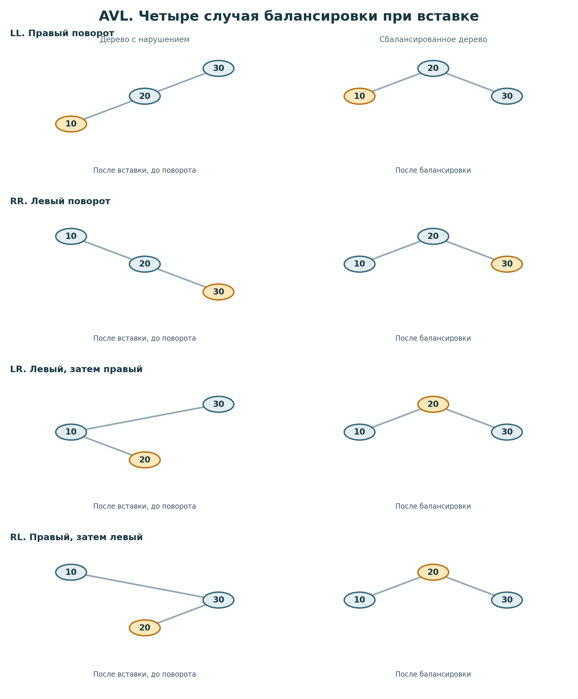
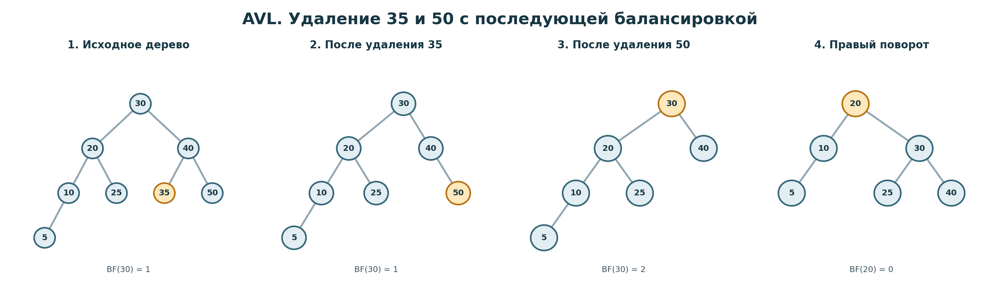

# Задача 3. AVL

## Корректность решения

Реализован класс AVL с операциями insert, delete и search. После каждой вставки и удаления дерево остаётся бинарным деревом поиска и сохраняет баланс по высоте.

Для каждого узла разница между высотами левого и правого поддерева не превышает 1. Поэтому высота всего дерева растёт логарифмически от количества элементов, а поиск, вставка и удаление не требуют последовательного просмотра всех узлов.

В узле хранятся значение, ссылки на потомков и высота поддерева с этим узлом в корне. Высота пустого поддерева равна 0, высота листа равна 1. При изменении структуры высоты пересчитываются снизу вверх.

Повторные значения не добавляются. Это позволяет сохранить строгое условие BST, при котором все значения слева меньше текущего, а справа больше. Метод insert возвращает True, если элемент добавлен, и False, если такое значение уже есть. Аналогично delete возвращает True при успешном удалении и False, если элемент отсутствует. Метод search возвращает True или False в зависимости от результата поиска.

## Идея решения

При вставке сначала выполняется обычный поиск подходящего места в BST. Если значение меньше текущего узла, продолжаем поиск слева, если больше, то справа. Новый узел создаётся на пустом месте.

После вставки функция возвращается назад по пути поиска. Для каждого пройденного узла пересчитывается высота и определяется balance factor, то есть высота левого поддерева минус высота правого.

Если модуль balance factor не превышает 1, ничего менять не нужно. Если разница стала больше, выполняется поворот. Он меняет расположение нескольких узлов, но сохраняет их порядок в BST.

Для перекоса влево и влево от левого потомка нужен один правый поворот, это случай LL. Для перекоса вправо и вправо от правого потомка нужен один левый поворот, это RR.

В случае LR сначала выполняется левый поворот вокруг левого потомка, после этого правый поворот вокруг текущего узла. Для RL порядок обратный, сначала правый поворот вокруг правого потомка, затем левый вокруг текущего узла.

Поиск работает как в обычном BST. На каждом шаге сравниваем значение с текущим узлом и выбираем только одно из поддеревьев. Если значения совпали, возвращается True. Если дошли до None, возвращается False. При поиске структура дерева не меняется.

Удаление сначала находит нужный элемент. Если у узла нет потомков, он удаляется. Если есть только один потомок, этот потомок занимает его место.

Если у удаляемого узла два потомка, берётся минимальный элемент правого поддерева, то есть следующий по величине. Его значение записывается в удаляемый узел, а исходный узел с этим значением удаляется из правого поддерева. Такой выбор сохраняет порядок BST, поскольку все значения слева остаются меньше нового значения узла, а справа больше.

После удаления высоты также пересчитываются на обратном пути. Это важно, поскольку удаление может уменьшить высоту поддерева и нарушить баланс у одного или нескольких предков. Для восстановления баланса используются те же четыре варианта поворотов.

## Оценка сложности

Пусть n это количество узлов дерева, h это его высота.

Поиск занимает O(h) времени. На каждом шаге рассматривается один узел и выбирается либо левое, либо правое поддерево. Поскольку AVL поддерживает высоту O(log n), получаем O(log n) времени.

Дополнительная память поиска O(1). Метод search реализован циклом и хранит только ссылку на текущий узел.

Вставка занимает O(log n) времени. Поиск места идёт по одному пути длины O(log n). При возврате по этому пути для каждого узла выполняется пересчёт высоты за O(1). Отдельный поворот также занимает O(1), так как меняет только несколько ссылок и высот.

Дополнительная память вставки O(log n), поскольку используется рекурсия и глубина стека ограничена высотой дерева. Для нового значения создаётся один узел, что требует O(1) памяти помимо стека.

Удаление также занимает O(log n) времени. Поиск удаляемого узла, поиск минимального элемента правого поддерева и последующее восстановление баланса выполняются по путям длины не более O(log n). На каждом пройденном узле требуется постоянное время.

Дополнительная память удаления O(log n) из-за рекурсивных вызовов. При удалении узла с двумя потомками вложенная рекурсия также проходит только по одной ветви дерева.

Для хранения n узлов требуется O(n) памяти. Дополнительный метод inorder проходит по всем узлам за O(n) времени и формирует список из n значений, поэтому его память вместе с результатом O(n).

## Визуализация

Сначала рассмотрим вставку значений 30, 20, 10.

После вставки 30 дерево состоит из одного корня. Значение 20 меньше 30, поэтому оно добавляется слева. Затем добавляется 10, оно меньше 30 и меньше 20, поэтому становится левым потомком узла 20.

У узла 30 высота левого поддерева теперь равна 2, а правого 0. Balance factor равен 2, что нарушает условие AVL. Это случай LL, поэтому выполняется правый поворот. Узел 20 становится корнем, 10 остаётся слева, а 30 становится справа. Высоты обоих поддеревьев равны 1, баланс восстановлен.

Остальные три вида поворотов показаны на втором рисунке. Во всех случаях после вставки трёх чисел получается одно дерево с корнем 20 и потомками 10 и 30, но последовательность поворотов различается.



Теперь рассмотрим пример, в котором баланс нарушается после удаления. Последовательно вставим [30, 20, 40, 10, 25, 35, 50, 5]. Получится дерево с корнем 30. Слева находится поддерево с корнем 20 и высотой 3, справа поддерево с корнем 40 и высотой 2. Разница высот равна 1, дерево сбалансировано.

Сначала удаляем 35. У этого узла нет потомков, поэтому он просто исчезает. Высота правого поддерева корня 30 остаётся равной 2, поскольку там ещё есть путь через 40 к 50. Баланс корня не нарушается.

Далее удаляем 50. Теперь справа от 30 остаётся только узел 40 с высотой 1, а левое поддерево по-прежнему имеет высоту 3. Balance factor корня 30 равен 2.

Левое поддерево корня 30 также тяжелее слева, поэтому выполняется один правый поворот вокруг 30. Корнем становится 20. Слева от него находится 10 с потомком 5, справа 30 с потомками 25 и 40. Высоты обоих поддеревьев нового корня равны 2. Дерево снова сбалансировано.



На исходном дереве можно также проследить поиск 25. Сначала сравниваем 25 с корнем 30 и переходим налево к 20. Поскольку 25 больше 20, переходим к его правому потомку 25. Значение найдено, поэтому search(25) возвращает True. Для поиска 26 после узла 25 переход был бы вправо, но там None, поэтому результат False.

## Тесты

Отдельно проверяются пустое дерево, единственный элемент, повторная вставка существующего значения, поиск отсутствующего числа, отрицательные значения, ноль и большие целые числа.

Для вставки есть четыре отдельных тестовых сценария LL, RR, LR и RL с проверкой итогового корня и потомков. Для удаления проверяются лист, узел с одним потомком, узел с двумя потомками, удаление корня, удаление отсутствующего значения и последовательное удаление всех узлов.

После операций проверяется не только ответ метода. Вспомогательная функция тестов обходит всё дерево и независимо пересчитывает настоящую высоту каждого поддерева. Она проверяет, что сохранённые высоты совпадают с вычисленными, что разница высот потомков каждого узла не больше 1, а все значения соблюдают ограничения BST от предков. Также проверяются размер дерева, отсортированный обход inorder и отсутствие повторного использования одного и того же узла.

Дополнительно проверяются все 120 порядков вставки пяти различных чисел и удаление элементов в обратном порядке, 18 серий по 380 случайных операций с независимой моделью на основе set, вставка 5000 чисел по возрастанию и вставка 3500 чисел по убыванию с последующим удалением всех элементов.

Отдельными тестами проверяются независимость двух экземпляров AVL, отсутствие изменений при поиске, отсутствие вывода при импорте и самостоятельный запуск файла с примером использования.

Тесты можно запустить из корня репозитория:

```bash
python -m pytest -q homework_5/AVL/test_avl.py
```

Для запуска небольшого примера работы с деревом:

```bash
python homework_5/AVL/avl.py
```
