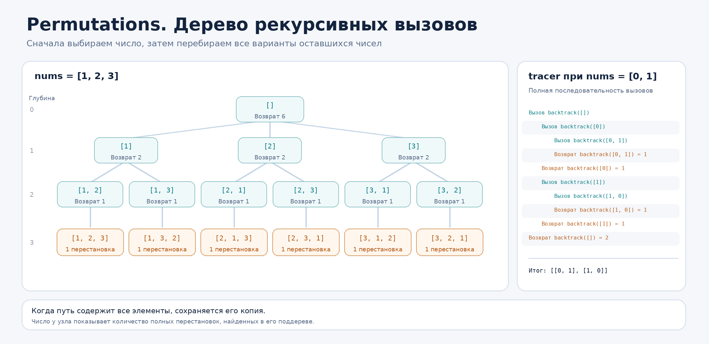

# Задача 2. Permutations

## Корректность решения

Функция permutations возвращает все перестановки элементов массива. Каждый результат содержит столько же элементов, сколько исходный массив, и использует каждый исходный элемент ровно один раз.

Решение перебирает все возможные варианты выбора следующего числа. После завершения одной ветви выбранное число освобождается, поэтому его можно использовать в других перестановках. Ни одна допустимая последовательность не пропускается.

Если в массиве есть одинаковые значения, одинаковые перестановки не добавляются несколько раз. Например, для [1, 1, 2] результат содержит [1, 1, 2], [1, 2, 1] и [2, 1, 1]. Для этого на каждом уровне рекурсии повторный выбор уже рассмотренного значения пропускается.

Исходный массив не изменяется. В результат сохраняются копии готовых перестановок, поэтому они не зависят друг от друга и от дальнейшей работы рекурсии. Для пустого массива возвращается [[]], поскольку существует одна перестановка без элементов.

## Идея решения

Использовал рекурсивный перебор с возвратом к предыдущему состоянию, то есть backtracking.

В списке path хранится текущая последовательность выбранных чисел. Массив used показывает, какие позиции исходного массива уже использованы в этой последовательности.

На каждом уровне функция backtrack перебирает элементы nums. Если позиция свободна и такое значение ещё не выбиралось на этом уровне, число добавляется в path, а его позиция отмечается в used.

После этого вызывается следующий уровень рекурсии. Когда длина path становится равна длине nums, получена одна полная перестановка. Её копия сохраняется в result.

После возврата число удаляется из конца path, а позиция в used снова становится свободной. Так можно проверить остальные варианты, не создавая новую копию пути при каждом вызове.

Отдельный набор seen создаётся на каждом уровне рекурсии и нужен только для исключения повторяющихся значений среди вариантов следующего элемента. Он не запрещает использовать одинаковые значения на других глубинах, если это разные позиции исходного массива.

Функция backtrack возвращает количество перестановок, полученных из текущей ветви. В базовом случае это 1, а выше результаты дочерних вызовов складываются в count. Сам список перестановок накапливается отдельно в result и возвращается внешней функцией permutations.

Чтобы показать стек вызовов, предусмотрел параметр trace. Если он равен True, внутренняя функция backtrack оборачивается декоратором tracer из первой задачи. При обычном вызове декоратор не используется и лишнего вывода нет. В трассировке видны текущий путь, отступ по глубине и количество готовых перестановок, полученных при возврате из каждой ветви.

## Оценка сложности

Пусть n это количество элементов массива. В худшем случае все числа различаются, и количество перестановок равно n!.

Время O(n * n!).

Для каждой готовой перестановки из n элементов создаётся копия списка. Уже на сохранение всех результатов нужно O(n * n!) времени. Остальные шаги перебора не меняют эту асимптотическую оценку: на каждом уровне рассматривается не более n позиций, а общее количество узлов дерева рекурсии имеет порядок O(n!).

Память результата O(n * n!).

Хранятся n! списков длины n. Это основная часть расхода памяти.

Дополнительная рабочая память O(n²).

Списки path и used занимают O(n), глубина рекурсии не превышает n. На каждом активном уровне создаётся свой набор seen, размер которого может достигать O(n). Поэтому для всех одновременно активных уровней верхняя граница дополнительной памяти составляет O(n²). Сам список result в эту оценку не входит.

При trace=True добавляются затраты на оформление и печать строк. Их длина зависит от глубины и размеров представлений аргументов. Для простых чисел суммарный вывод в худшем случае имеет порядок O(n * n!). Декоратор не устраняет ограничение Python на глубину рекурсии.

## Визуализация

Рассмотрим nums = [1, 2, 3].

Сначала path пустой. На первом уровне можно выбрать 1, 2 или 3.

Если выбрать 1, получится path = [1]. Далее можно выбрать 2 или 3, поскольку число 1 уже используется.

Выбирается 2. После этого path = [1, 2], свободным остаётся только 3. Добавление 3 даёт [1, 2, 3]. Длина пути стала равна трём, поэтому его копия сохраняется в результат. Этот вызов возвращает 1.

Затем 3 удаляется из пути, а после возврата на предыдущий уровень удаляется и 2. Теперь после 1 выбирается 3, затем 2. Получается [1, 3, 2]. Ветка, начинающаяся с 1, содержит две перестановки, поэтому backtrack([1]) возвращает 2.

Аналогично ветка с первым числом 2 даёт [2, 1, 3] и [2, 3, 1]. Ветка с первым числом 3 даёт [3, 1, 2] и [3, 2, 1]. После завершения всех трёх ветвей начальный вызов возвращает число 6.

При вызове permutations([1, 2, 3], trace=True) декоратор из первой задачи печатает следующий стек вызовов:

```text
Вызов backtrack([])
    Вызов backtrack([1])
        Вызов backtrack([1, 2])
            Вызов backtrack([1, 2, 3])
            Возврат backtrack([1, 2, 3]) = 1
        Возврат backtrack([1, 2]) = 1
        Вызов backtrack([1, 3])
            Вызов backtrack([1, 3, 2])
            Возврат backtrack([1, 3, 2]) = 1
        Возврат backtrack([1, 3]) = 1
    Возврат backtrack([1]) = 2
    Вызов backtrack([2])
        Вызов backtrack([2, 1])
            Вызов backtrack([2, 1, 3])
            Возврат backtrack([2, 1, 3]) = 1
        Возврат backtrack([2, 1]) = 1
        Вызов backtrack([2, 3])
            Вызов backtrack([2, 3, 1])
            Возврат backtrack([2, 3, 1]) = 1
        Возврат backtrack([2, 3]) = 1
    Возврат backtrack([2]) = 2
    Вызов backtrack([3])
        Вызов backtrack([3, 1])
            Вызов backtrack([3, 1, 2])
            Возврат backtrack([3, 1, 2]) = 1
        Возврат backtrack([3, 1]) = 1
        Вызов backtrack([3, 2])
            Вызов backtrack([3, 2, 1])
            Возврат backtrack([3, 2, 1]) = 1
        Возврат backtrack([3, 2]) = 1
    Возврат backtrack([3]) = 2
Возврат backtrack([]) = 6
```

В строках с вызовом показано текущее состояние path. Четыре дополнительных пробела означают переход на следующий уровень. При возврате указывается число завершённых перестановок из данной ветви. Отступ уменьшается, когда рекурсия возвращается к родительскому вызову.

На рисунке показано то же дерево рекурсивных вызовов. В правой части отдельно приведён полный вывод tracer для nums = [0, 1], чтобы можно было увидеть входы и возвраты без пропущенных строк.



## Тесты

Проверяются три примера из условия, пустой массив, массив из одного элемента, отрицательные числа, нули и входные массивы с разным порядком значений.

Отдельно проверяются дубликаты, в том числе массивы из одинаковых значений и массив из десяти элементов с повторениями. Проверяется, что входной список не изменяется, готовые перестановки сохраняются независимо друг от друга, а повторные вызовы не используют результат предыдущих запусков.

Для массивов с различными значениями проверяется количество перестановок от 0! до 8!, включая 40320 перестановок восьми элементов. Также перебираются все массивы длиной до пяти из значений 0, 1 и 2 и 150 случайных массивов. Ответы сверяются с независимым эталоном на основе itertools.permutations с удалением одинаковых результатов.

Для трассировки проверяются точные строки вызовов и возвратов, правильные отступы, значения возвращаемых счётчиков, отсутствие повторных ветвей для одинаковых значений и отсутствие вывода при trace=False.

Также проверены самостоятельный запуск программы как модуля и как обычного файла, режим --trace, обработка неверного типа входа и отсутствие побочного запуска программы при импорте.

Тесты нужно запускать из корня репозитория, так как решение использует tracer из соседней задачи:

```bash
python -m pytest -q homework_5/permutations/test_permutations.py
```

Чтобы получить перестановки в консоли, из корня репозитория выполняется:

```bash
python -m homework_5.permutations.permutations
```

После запуска нужно ввести список, например [1, 2, 3]. Для отображения рекурсивного стека можно добавить флаг --trace:

```bash
python -m homework_5.permutations.permutations --trace
```

Программу также можно запустить напрямую командой python homework_5/permutations/permutations.py. Для работы декоратора в репозитории должны находиться обе задачи пятой домашней работы, tracer и permutations.
