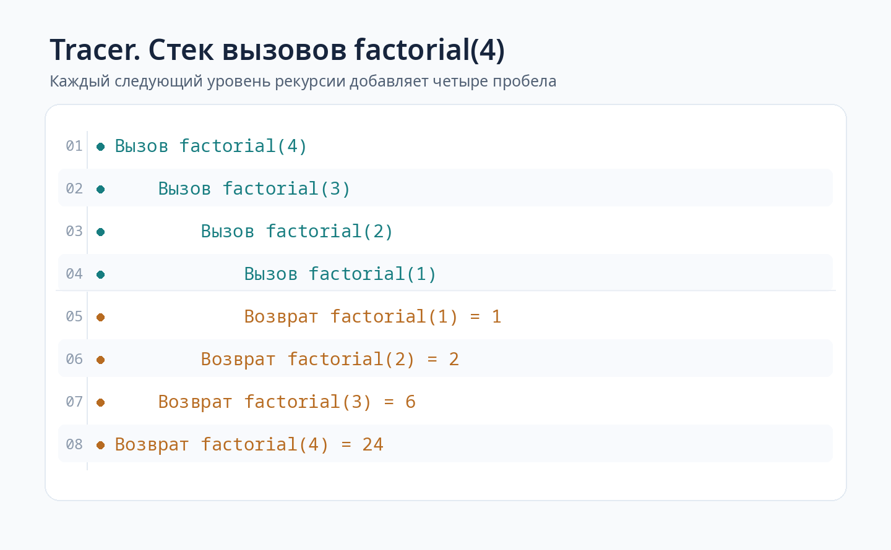

# Задача 1. Tracer

## Корректность решения

Реализовал декоратор tracer, который показывает порядок вызовов рекурсивной функции и значения, возвращаемые каждым вызовом.

Перед выполнением функции печатается строка с её именем и аргументами. После завершения печатается результат. Каждый новый уровень вложенности добавляет четыре пробела в начале строки, поэтому по выводу видно, какой вызов запустил следующий и в каком порядке рекурсия завершается.

Декоратор не изменяет переданные аргументы и возвращает именно результат исходной функции. Он подходит не только для факториала, но и для рекурсии с несколькими ветвями. Если одна декорированная функция вызывает другую, глубина стека продолжает увеличиваться, а не начинается заново.

Отдельно предусмотрел ситуацию, когда функция завершается с исключением. В этом случае печатается строка об ошибке, а исключение передаётся вызывающему коду. Глубина стека в любом случае восстанавливается, поэтому после ошибки следующий независимый вызов снова начинается без отступа.

## Идея решения

Декоратор принимает функцию func и возвращает обёртку wrapper. Благодаря этому исходную функцию можно оставить без изменений и просто поставить перед ней @tracer.

В начале wrapper получает текущую глубину из переменной _depth. Затем составляет строку вызова из имени функции, позиционных аргументов и именованных аргументов. Для значений используется repr, чтобы строки были видны с кавычками, а числа, списки и другие значения выводились в привычном для Python виде.

Перед вызовом исходной функции печатается строка с отступом. Отступ вычисляется как четыре пробела, умноженные на текущую глубину.

Далее глубина увеличивается на один уровень и выполняется func. Если внутри неё снова вызывается декорированная функция, её wrapper уже видит увеличенную глубину и печатает следующий вызов правее предыдущего.

После завершения func печатается строка возврата с тем же отступом, который был у входа в этот вызов. Возвращаемое значение сохраняется и передаётся наружу без изменений.

Для хранения глубины использовал ContextVar из стандартной библиотеки Python. Это позволяет разным декорированным функциям видеть общий уровень вложенности внутри одного контекста выполнения. Метод set возвращает token, который затем используется в reset для восстановления прежнего значения.

Восстановление глубины находится в finally. Этот блок выполняется и при обычном возврате, и при исключении. Поэтому счётчик не остаётся увеличенным после неудачного вызова. Декоратор wraps также сохраняет имя, документацию и другую информацию об исходной функции.

## Оценка сложности

Пусть k это количество вызовов декорированных функций, h максимальная глубина вложенности, а L общее количество символов, которые нужно сформировать и вывести.

Дополнительное время работы трассировки O(k + L), не считая времени выполнения самих рекурсивных функций.

Для каждого вызова декоратор один раз печатает вход и один раз возврат либо ошибку. На подготовку строк уходит время, зависящее от длины их представления. В частности, чем глубже вызов, тем длиннее строка отступа.

Поэтому для цепочки из h вызовов даже при коротких аргументах и результатах суммарная длина одних только отступов растёт как O(h²). Это важное отличие от обычного подсчёта вызовов: если учитывать настоящий вывод в консоль, время трассировки нельзя всегда назвать O(k).

Дополнительная память для цепочки вызовов с небольшими аргументами составляет O(h).

В каждый момент активны не более h вложенных обёрток. Каждая хранит свою глубину, token, строку вызова и несколько локальных переменных. Весь текст трассировки в список не собирается, а сразу передаётся в print. Если аргументы или возвращаемые значения имеют большое текстовое представление, память на их форматирование нужно учитывать отдельно.

Исходная рекурсивная функция также использует свой стек вызовов. Например, факториал вычисляется за O(n) арифметических шагов и требует O(n) глубины стека, если считать арифметические операции постоянными по стоимости. Трассировка добавляет к этому затраты на форматирование и печать. Сам декоратор не снимает ограничение Python на глубину рекурсии.

## Визуализация

Рассмотрим рекурсивное вычисление factorial(4). Функция возвращает 1 при n не больше 1, а в остальных случаях умножает n на результат factorial(n - 1).

Сначала вызывается factorial(4). Для получения ответа ему нужен factorial(3), поэтому возникает ещё один вызов с отступом в четыре пробела.

Внутри factorial(3) вызывается factorial(2), а затем factorial(1). Каждый вызов добавляет четыре пробела. На factorial(1) достигается базовый случай, результат равен 1.

После этого рекурсия начинает завершаться. factorial(2) получает 1 и возвращает 2. factorial(3) получает 2 и возвращает 6. Наконец, factorial(4) получает 6 и возвращает 24.

Полный вывод программы выглядит так:

```text
Вызов factorial(4)
    Вызов factorial(3)
        Вызов factorial(2)
            Вызов factorial(1)
            Возврат factorial(1) = 1
        Возврат factorial(2) = 2
    Возврат factorial(3) = 6
Возврат factorial(4) = 24
```

Первые четыре строки показывают последовательное погружение в рекурсию. Следующие четыре строки показывают возврат значений в обратном порядке. Отступ для возврата совпадает с отступом того вызова, которому он принадлежит.

Та же последовательность показана на изображении. Номера шагов на рисунке добавлены только для пояснения, сама программа печатает строки без номеров.



## Тесты

Тесты проверяют точный вывод для factorial(4), результаты вычисления факториала для нескольких аргументов, соответствие отступов глубине и совпадение строк входа и возврата.

Отдельно проверяются функции без аргументов, с позиционными и именованными аргументами, а также возврат None, логических значений, чисел, строк, списков и словарей. Есть проверка, что декоратор возвращает исходный объект, а не его строковое представление, и не изменяет входные списки.

Для нетривиальных случаев проверяются рекурсивные вычисления с двумя ветвями на примере чисел Фибоначчи и взаимная рекурсия двух декорированных функций. Проверяется, что их вызовы имеют общую последовательность уровней вложенности.

Проверяется обработка исключений на одном уровне и внутри рекурсии. Тесты подтверждают, что ошибка не подавляется, правильно отображается в трассировке и не оставляет увеличенную глубину для следующих вызовов. Отдельно проверяется ситуация, когда вызывающая функция сама перехватывает ошибку вложенного вызова и продолжает работу.

Есть тест на сохранение имени и документации функции через wraps, тест на рекурсию глубиной 101 вызов, а также проверка запуска tracer.py как самостоятельной программы и отсутствия побочного запуска примера при импорте.

Тесты запускаются из корня репозитория:

```bash
python -m pytest -q homework_5/tracer/test_tracer.py
```

Чтобы увидеть трассировку на примере факториала, можно выполнить:

```bash
python homework_5/tracer/tracer.py
```

Дополнительный ввод не требуется. Программа покажет последовательность вызовов factorial(4) и возвратов с результатами. Сам декоратор можно импортировать и применять к другим рекурсивным функциям.
